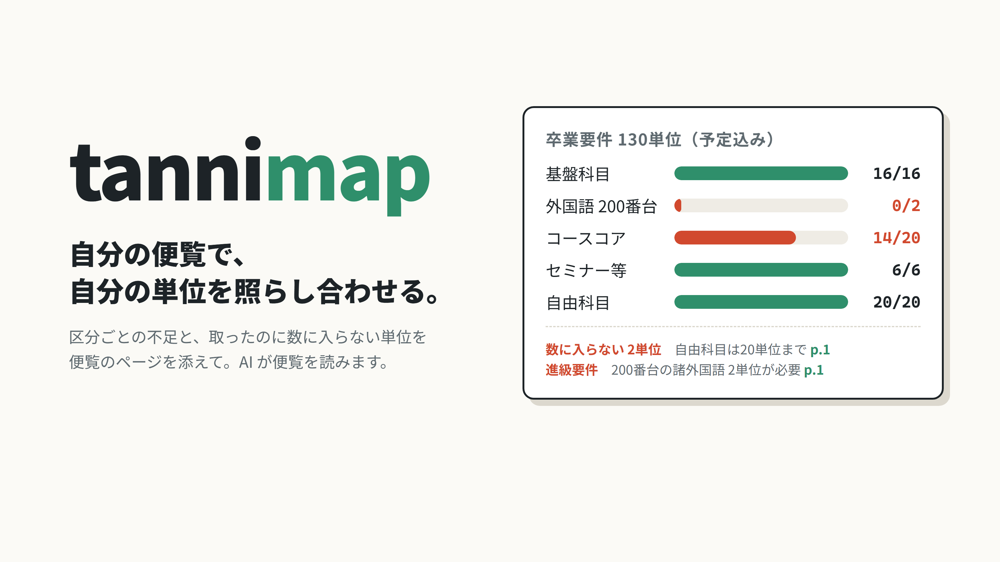

# tannimap（単位マップ）

**自分の大学の便覧（卒業要件）で、自分の成績と履修予定を照らし合わせるツール。**
区分ごとの不足と、「取ったのに卒業単位に数えられない単位」を、便覧のページとともに示します。

*tannimap checks a Japanese university student's grades and course plan against their own handbook's graduation rules — category minimums, caps, overflow between categories, required courses — and explains every credit that does not count, with page references. An AI skill turns the handbook into the rules file.*

## なぜ

「この単位で卒業できますか」「履修登録をミスした」「GPA の計算方法」は、Yahoo!知恵袋で毎年同じ形で質問され続けています。
しかし答えは、**その学生の便覧の規則**と**その学生の成績**を突き合わせないと出ません。第三者の回答は一般論になり、回答どうしで食い違うこともあります。

大学は確認を学生に任せています。

- 新潟大学法学部は2022年に、学務係による卒業要件の確認をやめ、「卒業要件の充足を確認する責任はいかなる場合も学生本人にある」と通知しました。
- 東京外国語大学は「起こりうる単位修得ミス」の一覧を公開しています。
- 法政大学人間環境学部のチェックシートには「毎年、単位の計算ミスの為に留級・卒業保留となる学生がいます」と書かれています。

学生が作ったチェッカーは10校以上にありますが、どれも1大学・1学部・1入学年度専用で、作者が卒業すると止まります。
規則は大学・学部・入学年度ごとに違い、作り手が全国分を保守するのは無理だからです。

tannimap は、この「規則をデータにする」部分を **AI に任せます**。
学生が自分の便覧を AI に渡すと、AI が便覧のページを根拠に規則ファイルを作り、学生がそれを便覧と見比べて確かめます。
照合そのものは、規則ファイルに従って毎回同じように計算するプログラムが行います。

作った経緯と測った結果は Zenn の記事「[「この単位で卒業できますか」に、自分の便覧で答えるツールを作った](https://zenn.dev/yukidev25/articles/ee3d255560f0d8)」にもまとめています。
調査と、作る前に確かめた内容は [docs/research](docs/research/REPORT.md)、効果測定は [docs/EVALUATION.md](docs/EVALUATION.md) にあります。

## できること

```
$ tannimap check rules.json 成績.csv --plan 履修予定.csv --entry-year 2024

■ 予定どおり修得しても残る問題
  ! 4群（諸外国語科目）200番台: 2単位不足（チェックシート 3年→4年の列）
  ! コースコア: 6単位不足（p.1）
■ 今は足りないが、履修中・予定の科目を修得すれば解消するもの
  - 1群（人文科学分野）: 2単位不足（p.1）
■ 卒業単位に含まれない単位（修得しても数に入らない）
  - キャリアチャレンジII 2単位: 「キャリアチャレンジ」は6単位まで。卒業単位に含まれない（p.1）
  - 自由科目群5 2単位: 自由科目は20単位までしか算入されない。卒業単位に含まれない（p.1）
■ 3年→4年 進級要件: 満たしていない（修得済）／満たしていない（予定込み）
■ 学務に聞くこと
  - ...
```

- **区分ごとの最低単位**（入れ子の区分、「A を○単位含めて計○単位」）
- **算入の上限**（修得上限、「○単位までしか卒業要件に認められない」、同一授業科目は○単位まで）
- **別の区分への振替**（「超えた分は関連科目に含めることができる」とその上限）
- **算入されない科目**（教職・資格科目、履修できない科目）
- **必修科目**（未修得・履修中・予定・不合格を区別。「春学期のみ登録可」も表示）
- **どれか1つの方法で満たす要件**、**ひとつの言語で○単位**
- **進級要件**（累計、区分、「1年次に○単位」、「2年次までに○単位」、進級に必要な科目）
- **履修予定込みの判定**：履修登録の前に「この予定で足りるか」を確かめる
- GPA（規則に評語ごとの点数があるときだけ）、給付奨学金の単位の基準（6割・7割）の目安
- 規則にない区分の科目や、成績表に一度も出てこない区分名・科目名の条件を警告（推測した書き方が黙って0単位になるのを防ぐ）
- 不合格の科目、今回は照合しない区分（「全学共通科目だけ見たい」）も分けて表示

**「卒業できます」とは言いません。** 出すのは便覧の規則に照らした目安と、学務に聞くことのリストです。

## 使い方

**AI（Claude Code）と使う**：`.claude/skills/tannimap/` のスキルが、便覧 → 規則ファイル → 確認 → 照合までを案内します。
自分の便覧の卒業要件のページ（PDF）と、ポータルから出した成績（CSV か、表のコピー）を渡して「卒業までに何が足りないか見て」と頼んでください。

**コマンドで使う**

```bash
pip install git+https://github.com/yukijames25/tannimap
tannimap template rules > rules.json        # 規則ファイルのひな形
tannimap validate rules.json                # 誤りと怪しい点
tannimap explain rules.json                 # 規則を日本語で言い直す（便覧と見比べる）
tannimap check rules.json 成績.csv --plan 履修予定.csv --entry-year 2024 [--years 2]
```

**ブラウザで使う（インストール不要）**：`web/index.html` を開き、規則ファイル・成績・履修予定を貼り付けます。
1ファイルで、ページ自体が外部への通信を禁止しているので、成績は端末の外に出ません。中身は Python 版と同じ計算で、4大学・241通りの成績で、出力の文章まで一致することをテストしています。

## 正しさの確かめ方

- **大学自身の正解例**：東京外国語大学の「起こりうる単位修得ミスについて」（言語文化学部）に載っている事例のうち、単位数が書かれているもの（2016年度以降入学者向け）が、大学が書いているとおりの判定になるかテストしています（`tests/test_mistakes.py`）。指導教員ごとの本ゼミのように成績表から判断できないものは、「学務に聞くこと」に回しています。
- **AI が作った規則と、人が作った正解の規則の一致**：初めて見る AI に3つの大学（法政・香川・熊本県立）の公開資料から規則を作らせ、人が作った正解の規則とランダムな成績500通りで判定を比べました（`tools/compare_rules.py`）。卒業の判定は3回とも100%一致し、仕込んだ落とし穴も 6/6・9/9・8/8 見つけました。詳しくは [docs/EVALUATION.md](docs/EVALUATION.md)。

## 制限

- 規則ファイルの正しさは、作った AI と、それを便覧と見比べる学生にかかっています。`explain` の出力を便覧と見比べる手順を省かないでください。
- 年次ごとの要件は、成績表に年度の列があり、入学年度を指定したときだけ判定します。
- 「GPA 下位4分の1」や出席率など、大学のデータが必要な基準は判定しません。
- 大学の学務システムが不足単位を表示している場合は、まずそちらが公式です。tannimap が役に立つのは、システムが判定しない学部、履修登録前の計画、そして「なぜその数字になるのか」を知りたいときです。

## 開発

```bash
python -m unittest discover -s tests     # node があればブラウザ版との一致も
python tools/compare_rules.py KEY.json OTHER.json --labels-from 成績.csv
```

License: MIT
