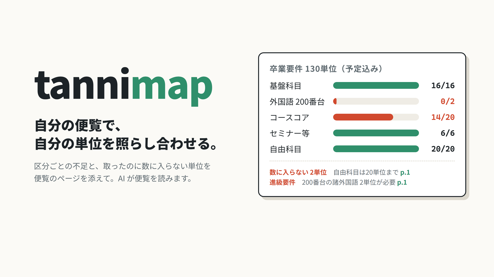

Yahoo!知恵袋には、毎年同じ形の質問が並びます。「この単位数で卒業できますか」「履修登録をミスしました」「GPAの計算方法を教えてください」。

でも、この質問に第三者は正しく答えられません。答えは**その学生の大学・学部・入学年度の便覧**と、**その学生の成績**を突き合わせないと出ないからです。実際に回答を読むと、一般論で答えていて、回答どうしで食い違っていることもあります。

そこで、学生が自分の便覧を AI に渡すと、AI が便覧のページを根拠に「規則ファイル」を作り、プログラムが成績と履修予定を照らし合わせる道具 **tannimap（単位マップ）** を作りました。

https://github.com/yukijames25/tannimap

## 作る前に、5つの候補を確かめて4つ捨てた

今回は「学生の困りごとを解決する」ことが目的でした。思いつきで作らないよう、先に調べました。

- 大規模調査（大学生協・JASSO）、知恵袋で繰り返される質問、学生が自作したツール、少数派の学生（留学生・研究室・実習のある学部）を、8つの観点で調べた
- 候補を5つに絞り、それぞれ「作らない理由」を探しにいった

| 候補 | 確かめた結果 |
|---|---|
| 留学生のアルバイト「週28時間」チェッカー | 2026年に専用アプリが次々出ていた。超過の多くは知っていての超過で、計算機では解けない |
| 税と社会保険の「年収の壁」チェッカー | 質問は一番多いが、2026年だけで同種の iOS アプリが8本以上 |
| 個人開発者向けのマーケティング支援 | 英語圏は飽和。日本語版を求める声も、自作する人も見つからない |
| 要件から GitHub 公開までの一貫ツール | GitHub・各社のエージェントの標準機能になっていた |
| **卒業要件の照合** | 学生の自作チェッカーが10校以上にあるのに、どれも1大学・1学部専用。汎用のものが無い |

全国共通のルール（28時間・年収の壁）は、制度が変わるとすぐ誰かが作ります。一方、大学ごとに違う卒業要件は、学生が何度作っても汎用のものが出てきません。規則をデータにする手間が大きすぎるからです。

そして、その手間こそ AI が肩代わりできる部分でした。

もちろん、弱点も確かめました。学務システムが区分ごとの不足を表示してくれる大学は、思ったより多くありました。知恵袋の「卒業できますか」を13件開くと、この道具ではっきり答えられるのは3件でした。だから狙いは、4年生の「卒業できる？」という不安ではありません。**履修登録の前の計画**と、**「なぜその数字になるのか」の説明**です。

## できること

```
$ tannimap check rules.json 成績.csv --plan 履修予定.csv --entry-year 2024

■ 予定どおり修得しても残る問題
  ! 4群（諸外国語科目）200番台: 2単位不足
  ! コースコア: 6単位不足（p.1）
■ 今は足りないが、履修中・予定の科目を修得すれば解消するもの
  - 1群（人文科学分野）: 2単位不足（p.1）
■ 卒業単位に含まれない単位（修得しても数に入らない）
  - キャリアチャレンジII 2単位: 「キャリアチャレンジ」は6単位まで。卒業単位に含まれない（p.1）
■ 3年→4年 進級要件: 満たしていない（修得済）／満たしていない（予定込み）
```

便覧には、学生がつまずく細かい規則がたくさんあります。

- 「（4単位）」と括弧付きなら上限、「1単位」なら必修でそれ以上は認めない、「2単位以上」なら超えた分も数える（香川大学）
- 必修を超えた分は関連科目に回せる。ただし入学年度で扱いが違う（東京外国語大学）
- 同じ授業科目は1授業2単位まで。実験科目は除く（香川大学）
- 他学部の科目は10単位まで。教職科目は卒業要件に含まない（熊本県立大学）
- 2年次までに、この5科目を含む39単位（熊本県立大学）

tannimap はこれを規則ファイル（JSON）に書き、**取ったのに数に入らない単位には、その理由と便覧のページを付けて**出します。「卒業できます」とは言いません。出すのは目安と、学務に聞くことのリストです。

## AI が便覧を読み、プログラムが数える

役割を分けています。

- **AI（Claude Code のスキル）**：便覧の要件表と注意書きを読み、規則ファイルにする。すべての区分に根拠のページを付け、学生に見比べてもらう
- **プログラム（Python 標準ライブラリだけ）**：規則ファイルに従って、毎回同じように数える

AI に直接「卒業できる？」と聞くと、もっともらしいが確かめようのない答えが返ってきます。規則ファイルにしておけば、学生は `tannimap explain` の出力を便覧と1行ずつ見比べられます。計算はプログラムがやるので、数え間違いもありません。

ブラウザ版もあります。1つの HTML ファイルで、ページ自体が外部への通信を禁止しているので、成績は端末の外に出ません。Python 版と同じ計算で、4大学・241通りの成績で、出力の文章まで一致することをテストしています。

## 「初めて見る AI」に3つの大学の便覧を読ませた

一番の不安は「AI は本当に便覧を正しく読めるのか」でした。そこで masume・kanjiframe のときと同じく、利用者役のエージェントに相談文と便覧の PDF だけを渡し、規則ファイル作りから回答までやらせました。成績には、本人には知らせずに落とし穴を仕込んであります。

AI が作った規則の正しさは、私が便覧から作った正解の規則と比べて測りました。ランダムな成績500通りで、両方の判定（数える単位・不足・数に入らない単位・すべて満たすか）が一致するかを見ます。

| | 1回目 | 2回目 | 3回目 |
|---|---|---|---|
| 大学の資料 | 法政大学（チェックシート） | 香川大学（17ページの便覧） | 熊本県立大学（注記の多い抜粋） |
| 仕込んだ落とし穴を見つけた数 | 6 / 6 | 9 / 9 | 8 / 8 |
| AI の規則と正解の規則の一致（卒業の判定） | 100% | 100% | 100% |
| エラーになったコマンド | 2 | 2 | 0 |

3回とも、初めて見る AI が作った規則で、卒業の判定が正解と一致しました。2回目は、AI が凡例のページを読み、「○単位」を「ちょうど○単位で、超えた分は認めない」と正しく解釈しています。3回目は、私が成績表を作るときに誤った区分を付けてしまった科目に気づき、「ビジネス分野ではないか、学務に確かめて」と書いてきました。

それでも、使わせて初めて分かった危ないところがありました。

- **GPA を他大学の点数で計算していた**。規則に評語の点数を書かなかったのに既定の点数で計算し、AI 自身が「あてにしないで」と利用者に書く羽目になった → 点数が無ければ計算しない
- **推測で書いた区分名が、黙って0単位になる**。成績表に一度も出てこない区分名を、AI が仮に置いた → 成績表に出てこない区分名・科目名の条件を警告する
- **「今回は照合しない」専門科目が「数に入らない単位」と出て、ムダに見えた** → 「今回は照合していない区分」と分けて表示
- **上限で外した科目の名前が出て、その科目自体がだめだと受け取られる** → 「どの科目を外すかは計算の都合」と注記

測った数字と直したことの一覧は [docs/EVALUATION.md](https://github.com/yukijames25/tannimap/blob/main/docs/EVALUATION.md)、作る前の調査は [docs/research](https://github.com/yukijames25/tannimap/blob/main/docs/research/REPORT.md) にあります。

## できないこと

- 規則ファイルの正しさは、作った AI と、それを便覧と見比べる学生にかかっています
- 「GPA 下位4分の1」や出席率のように、大学のデータが必要な基準は判定しません
- 大学の学務システムが不足単位を判定してくれるなら、まずそちらが公式です
- テストの成績はすべて私が作った架空のものです。実際の学生にはまだ使ってもらっていません

## おわりに

大学の便覧を読み解くのは、本来は学生本人の仕事とされています。でも、注意書きの多い要件表を自分の成績に当てはめるのは、慣れないとかなり難しい作業です。お手元の便覧で試して、読み違いや分かりにくい表示があれば [Issue](https://github.com/yukijames25/tannimap/issues) で教えてください。成績そのものは貼らず、規則ファイルと、問題が出た区分の行だけで十分です。

https://github.com/yukijames25/tannimap
